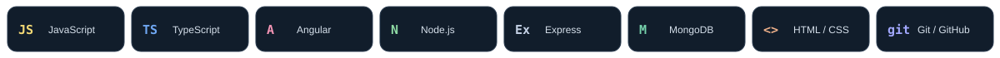
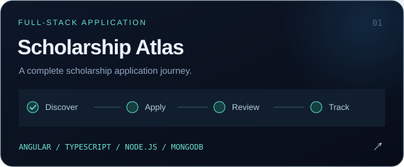
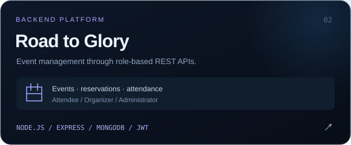
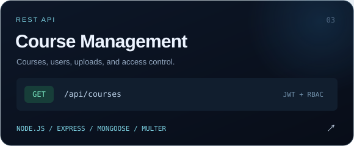
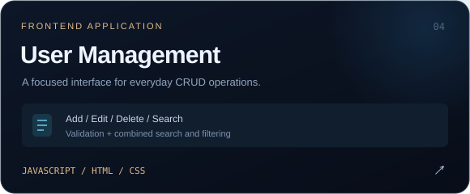
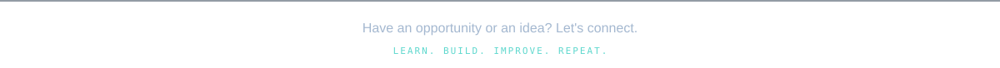

<!-- Upload README.md and assets/ together to the root of amotaz668-create/amotaz668-create. -->

  

  <a href="https://www.linkedin.com/in/moataz-ahmed-0153403a0/"><strong>LinkedIn ↗</strong></a>
  &nbsp; · &nbsp;
  <a href="https://github.com/amotaz668-create?tab=repositories"><strong>Explore my repositories ↗</strong></a>
  &nbsp; · &nbsp;
  <a href="https://github.com/amotaz668-create/amotaz668-create.github.io"><strong>Portfolio source ↗</strong></a>

## A little about me

I'm **Moataz**, a Computer Science student in Giza, Egypt, focused on web development with **Angular, Node.js, Express, and MongoDB**.

My projects cover scholarship applications, event management, and course APIs. I enjoy connecting useful interfaces to well-structured backend services and turning what I learn into working applications.

- **Backend focus:** REST APIs, JWT authentication, role-based authorization, validation, and MongoDB data models.
- **Frontend work:** Angular and TypeScript, plus HTML, CSS, and JavaScript.
- **Next opportunity:** internships and junior software engineering roles where I can contribute and keep improving.

## Tools I build with

  

## Selected projects

<table>
  <tr>
    <td width="50%" valign="top">
      
      
Scholarship discovery and application tracking, with separate student, employee, and administrator workflows.

      
<strong>Explore:</strong> role-based access, document uploads, application status transitions, and Arabic/English interfaces.

      
<a href="https://github.com/amotaz668-create/Scholarship_project"><strong>View repository ↗</strong></a> · <a href="https://github.com/amotaz668-create/Scholarship_project/blob/main/API_MAP.md">API map</a>

    </td>
    <td width="50%" valign="top">
      
      
An event management backend for attendees, organizers, and administrators, built with Express and MongoDB.

      
<strong>Explore:</strong> event reservations, tickets, attendance, feedback, JWT authentication, and role-based permissions.

      
<a href="https://github.com/amotaz668-create/Road-to-Glory"><strong>View repository ↗</strong></a>

    </td>
  </tr>
  <tr>
    <td width="50%" valign="top">
      
      
A course and user management API using Node.js, Express, MongoDB, and Mongoose.

      
<strong>Explore:</strong> protected CRUD operations, JWT authorization, request validation, pagination, and Multer uploads.

      
<a href="https://github.com/amotaz668-create/Course-Management-REST-API"><strong>View repository ↗</strong></a>

    </td>
    <td width="50%" valign="top">
      
      
A user management interface built with HTML, CSS, and vanilla JavaScript.

      
<strong>Explore:</strong> add, edit, and delete flows, form validation, live search by name or email, and specialty filters.

      
<a href="https://github.com/amotaz668-create/Nodejs_Project1"><strong>View repository ↗</strong></a>

    </td>
  </tr>
</table>

## What I care about

**Clear API boundaries. Useful user flows. Learning by building.**

I aim to make projects easier to understand through readable structure and documentation, and to improve them one practical step at a time.

  

